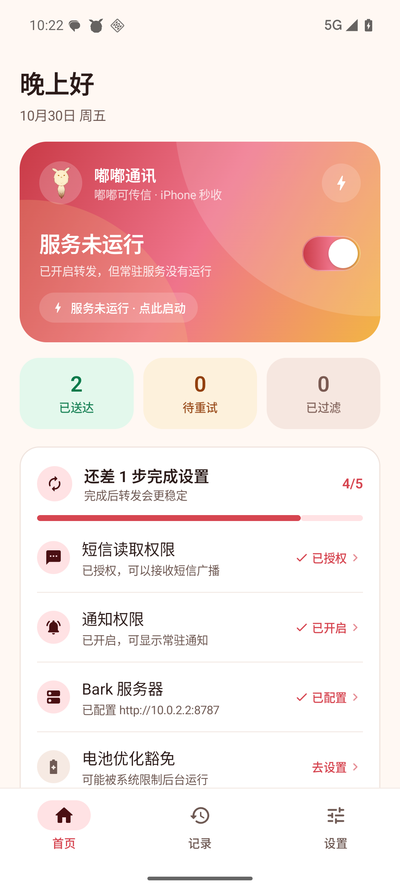
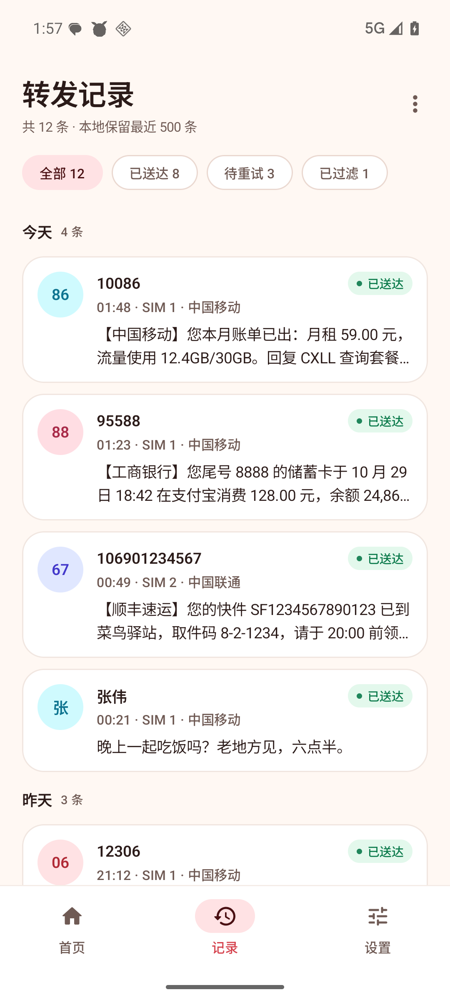
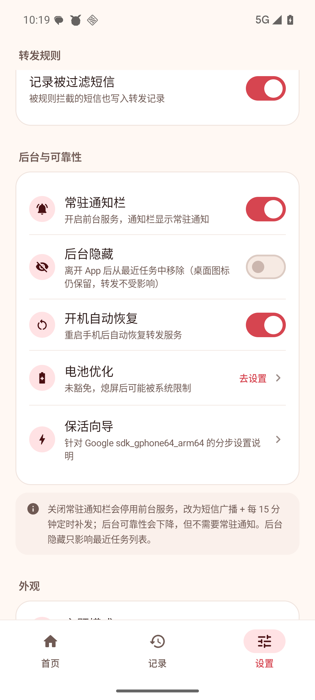

# 嘟嘟通讯 · DodoComm

> 可莉的嘟嘟可帮你传信：把安卓手机收到的短信，实时转发到 Bark / ntfy / Telegram / Pushover / Email 等推送通道，接收端即刻收到通知。

面向 Android 8+，对常见定制系统提供图文后台设置向导。
纯原生 Kotlin + Jetpack Compose，无广告、无统计、无后台上传，只把你配置的短信发送到你自己填写的推送服务或 SMTP 服务器。

<p align="center"><b>安装包</b>：<a href="https://github.com/PeterPanZH/dodocomm/releases/latest">GitHub Releases</a> · <b>使用说明</b>：<code>docs/使用说明.md</code></p>

| 首页 | 转发记录 | 后台选项 |
| --- | --- | --- |
|  |  |  |

> 深色模式、记录详情、设置页、应用内更新等更多截图见 [`screenshots/`](screenshots/)。

## 功能

- **实时转发**：收到短信后立即发送到你配置的推送通道，验证码、银行通知、快递信息一条不漏。
- **长短信 / 双卡**：自动拼接多段长短信；可选显示「SIM 2 · 中国移动」之类的卡槽标签。
- **失败自动重试**：断网、服务器临时不可用时进入 WorkManager 重试队列（指数退避，最多 5 次）。
- **本地记录**：最近 500 条转发记录，含成功/失败/已过滤状态、失败原因，可一键重发、复制、删除。
- **转发规则**：发送者白名单/黑名单、关键词黑名单，号码支持 +86 前缀与后缀匹配。
- **Bark 样式自定义**：标题模板（`{sender}`/`{sim}`/`{time}`/`{device}`/`{number}`）、分组、铃声、通知级别、图标、点击跳转、归档、自动复制、角标。
- **正规后台保活**：`specialUse` 前台服务 + 开机自启 + 电池优化豁免引导 + 15 分钟维护任务；**不使用**后台静音音频、无障碍服务、1px Activity 等黑科技。
- **常驻通知栏开关**：可在设置中关闭常驻通知（同时停用前台服务，改为短信广播 + 定时补发），不需要常驻通知也能用。
- **后台隐藏**：开启后离开 App 即从最近任务列表移除；桌面图标、常驻通知与短信转发均不受影响。
- **应用锁**：6 位 PIN + 可选指纹/面容解锁，自动锁定、防截屏、最近任务缩略图隐藏。
- **搜索与筛选**：记录页可按号码/内容搜索，按发送者、关键词、时间范围筛选。
- **验证码**：自动识别验证码并高亮；复制模式可选「不复制 / 全文 / 仅验证码」。
- **通知动作**：常驻通知支持「暂停 30 分钟」/「恢复转发」/「停止」。
- **多通道推送**：Bark、ntfy、Telegram、Pushover、Email(SMTP)，可同时启用，支持单通道测试。
- **路由规则**：按发送者、关键词、SIM 槽位和时间段选择目标通道，支持首条命中停止与回退。
- **重试策略**：最大次数、15s/1min/5min 退避、仅 Wi-Fi、最大重试时长。
- **标题/消息体模板**：标题默认 `{device} · {sender}`，消息体默认在原文后附 `{datetime} · {sim} · {number}`；可自定义变量，模板不含 `{body}` 时原文仍保留。
- **数据管理**：记录保留期限/条数上限/立即清理；CSV/JSON 导出（可脱敏）；配置加密备份（密码短语 + 本机密钥/生物识别双通道）。
- **多语言**：简体中文 / English / 日本語，默认跟随系统，也可在「外观 → 语言」中手动切换。
- **Android 16 适配**：系统可能限制「开机后立刻启动常驻服务」。若发生，会自动发一条可点击的「服务未自动恢复」通知，打开 App 即恢复；短信接收与即时转发始终由系统短信广播保障。
- **应用内更新**：从公开的 GitHub Releases 检查新版本（手动/自动），下载后校验 SHA-256 与签名，再交给系统安装器；自动检查成功时每 24 小时一次，失败按 1h→2h→…→24h 指数退避。
- **精致 UI**：Material 3、深浅色主题、品牌渐变、可选跟随系统取色；针对不同定制系统提供对应的图文后台向导。

## 快速开始

1. 从 [GitHub Releases](https://github.com/PeterPanZH/dodocomm/releases/latest) 下载最新 `DodoComm-<版本>.apk` 并安装（需允许「安装未知来源应用」）。
2. 打开 App，在「设置 → 推送 → 推送通道 → Bark」填入：
   - **服务器地址**：官方 `https://api.day.app`，或你的自建地址（如 `http://10.0.0.8:8080`，局域网 http 也可以）；
   - **Device Key**：Bark App 首页复制到的设备 Key。
3. 点「测试连接」，接收端应立刻收到一条测试推送。
4. 回首页完成检查清单：短信权限、通知权限、电池优化、自启动。
5. 收到短信后，首页与「记录」页可查看转发状态。

## 后台设置（按系统类型）

- **国产定制系统**：允许应用自启动；关闭电池限制；在最近任务中锁定应用；保留常驻通知。
- **类原生 Android**：电池优化设为「不受限制」；保留常驻通知。

App 内置「后台设置向导」会按当前系统类型给出对应步骤，并可直接跳转系统设置页。这些都是 Android 官方提供的能力，长期运行合规、可靠、可解释。

## 为什么不用「黑科技」保活

本应用只使用官方机制：

| 机制 | 作用 |
| --- | --- |
| `SMS_RECEIVED` 清单广播 | 即使进程被系统回收，短信到达时仍能唤醒应用处理 |
| `specialUse` 前台服务 | 常驻通知 + 系统允许长期运行；Android 15 的 6 小时限制只针对 `dataSync` 等类型 |
| `BOOT_COMPLETED` 接收器 | 重启/应用更新后自动恢复服务（从接收器的豁免上下文启动；失败时发恢复通知） |
| 电池优化豁免（用户手动确认） | 避免 Doze 冻结 |
| WorkManager 周期任务 | 每 15 分钟补发失败消息、清理记录、自愈服务 |

不使用后台播放音频、无障碍服务、循环闹钟、伪造通知等会耗电或违反系统策略的方式。

## 数据与隐私

- 只申请 `RECEIVE_SMS`（必需）、通知、前台服务、开机广播、网络；`READ_PHONE_STATE` 为**可选**，仅用于显示双卡标签。
- 短信内容只发送到**你自己填写的**推送服务或 SMTP 服务器；应用不含任何第三方统计/广告 SDK。
- 本地历史保存在 App 私有 SQLite 数据库中，最多 500 条，可在设置页一键清空。
- 不申请 `READ_SMS`，不读取历史短信，不读取联系人。

## 构建

要求：JDK 17+（推荐 21）、Android SDK（platform 37.2 / build-tools 37.0.0）、Gradle 9.6（仓库自带 wrapper）。

```bash
# 1) 准备 local.properties（指向你的 Android SDK）
echo "sdk.dir=/path/to/android-sdk" > local.properties

# 2) 构建 debug APK
./gradlew :app:assembleDebug

# 3)（可选）构建经过 R8 压缩的 release APK，并用仓库内自签名证书签名
./gradlew :app:assembleRelease
$ANDROID_HOME/build-tools/37.0.0/zipalign -f -p 4 \
  app/build/outputs/apk/release/app-release-unsigned.apk /tmp/dodocomm-aligned.apk
$ANDROID_HOME/build-tools/37.0.0/apksigner sign \
  --ks "$KEYSTORE_PATH" --ks-pass "env:KEYSTORE_PASSWORD" \
  --key-pass "env:KEY_PASSWORD" --out release/DodoComm-1.6.0.apk /tmp/dodocomm-aligned.apk
```

> 国内网络可用镜像替换 `gradle/wrapper/gradle-wrapper.properties` 中的 `distributionUrl`
> （如 `https://mirrors.cloud.tencent.com/gradle/gradle-9.6.0-bin.zip`）。
> Release 签名使用仓库内自签名 keystore（见 `keystore/`），仅用于个人侧载，不用于上架应用商店。

## 设计主题

- 吉祥物「嘟嘟可」：平滑 2D 画风（无毛绒噪点），白奶油色身体、长耳（金色耳尖）、豆豆眼、小尾巴 + 四叶草，参考原神可莉相关同人图风格。
- 主题色：可莉红 `#D64550` / 玫瑰粉 `#EF748B` / 四叶草金 `#F2B544`；浅色为暖奶油底，深色为暖棕黑底。
- 首页品牌位、未配置引导、记录空状态使用嘟嘟可插画；通知小图标为嘟嘟可剪影。
- 关于页注明「非官方同人作品，与米哈游无关」。

## 技术栈

- Kotlin 2.4.21 · AGP 9.5.0（built-in Kotlin）· Gradle 9.6.0 · JDK 21 / Java 17 target
- Jetpack Compose（BOM 2026.09.00，Material3 1.4）· Navigation Compose · Lifecycle/Flow
- WorkManager 2.12 · OkHttp 5.5.1 · 原生 SQLite（无 Room/KSP，构建轻量）
- AI/API：**Bark API V2**（`POST /push`，兼容 GET V1 回退）

## 目录

```
sms2bark/
├── app/src/main/java/com/dodocomm/app/
│   ├── core/       共享模型、设置、SQLite、权限、系统导航、OEM 向导
│   ├── sms/        短信广播接收与解析
│   ├── bark/       Bark API 客户端
│   ├── forward/    过滤规则、标题模板、转发引擎
│   ├── service/    前台服务、通知、开机恢复
│   ├── work/       WorkManager 补发与维护
│   └── ui/         Compose 界面与主题
├── docs/           架构、UI 规范、使用说明
├── scripts/        模拟器 / Mock Bark / E2E 脚本
├── screenshots/    界面截图（模拟器实拍）
└── release/        交付 APK
```

## 已验证（Android 16 模拟器，端到端）

**构建 / 质量**
- `assembleDebug`、`assembleRelease`（R8 压缩 + 资源收缩）均构建成功；**单元测试 57/57 通过**；`lintDebug` **0 errors**（14 warnings 为风格/版本提示）。
- Release APK：约 2.4 MB，V3 签名；模拟器 release 冷启动约 250 ms（debug 约 940 ms）。

**功能端到端（release 构建，真实 UI 操作，无 debug 后门）**
- 在设置页真实输入服务器地址 + Device Key →「测试连接」→ Mock Bark 收到正确 `POST /push`；
- 注入真实短信 → release 版 `SmsReceiver` 收到系统广播 → `ForwardEngine` 落库 → `POST /push`（title/body/device_key/group/level/isArchive 全部正确）→ 记录状态 `SENT`；
- 前台服务为 `specialUse` 类型（`isForeground=true, types=0x40000000`），常驻通知含「暂停 / 测试」动作；release 包不可调试、无 debug 组件。
- Release smoke：**PASS 24 / FAIL 0 / WARN 0**（真实 UI 配置 → 测试推送 → 真实短信 → Mock Bark POST → 记录已送达）。
- 1.7.0：应用锁 PIN 实测可锁定/解锁；备份加密单测覆盖密码/设备包装；导出 CSV/JSON 单测覆盖脱敏与注入防护。
- 1.5.0 新增验证：模拟器注入短信后标题正确渲染 `{device}`（`{number}` 在模拟器无号码时自动清理）；「后台隐藏」开启后按 Home，最近任务中不再出现本应用，前台服务仍在运行；关闭「常驻通知栏」后前台服务停止且通知移除，重新打开后恢复。

**韧性验证（debug 构建）**
- 断网失败自动进 WorkManager 重试队列 → 网络恢复后同一条记录 `FAILED → SENT`（15 s 退避，尝试次数受限）；
- 未配置服务器时安全失败（记录原因、不崩溃、不发通知轰炸）；
- 重启手机后常驻服务自动恢复（Android 16 AOSP 下从 BOOT_COMPLETED 豁免上下文启动；被系统/OEM 拦截时会发「服务未自动恢复」可点击通知）。

**证据**
- 截图：[`screenshots/`](screenshots/)（浅色/深色、空状态、设置与后台选项、release 构建实拍）。


## 应用内更新

- 更新源：**公开的 GitHub Releases**（源码公开后无需 token）。每个 release 附带 `latest.json` 与 `DodoComm-<version>.apk`：
  `https://github.com/PeterPanZH/dodocomm/releases/latest/download/latest.json`
- 手动检查：「设置 → 检查更新」；发现新版本后可下载并跳转系统安装器。
- 自动检查：可在设置中开关（默认开）。**成功时每 24 小时最多检查一次；失败按 1h → 2h → 4h → … → 24h 指数退避**，不会频繁请求。
- 安全：仅接受 `versionCode` 更高的版本；校验 `sha256`、文件大小和 APK 签名证书与当前应用一致，校验通过后才交给系统安装器。更新只覆盖安装，不静默安装。
- 说明：Android 更新要求签名一致；本仓库的 release 使用同一签名证书。从旧包名/旧签名迁移到本公开版本时，需要卸载旧版后重新安装一次。

## CI：GitHub Actions 自动发版

- 工作流：`.github/workflows/release.yml`
- 触发：push tag `v*`，或在 Actions 页面手动 `Run workflow`（可留空 tag，自动用 `v<versionName>`）
- 流程：JDK 21 + Android SDK 37.2 + Gradle 9.6 → 构建 release（R8）+ 单测 → 用 GitHub Secrets 中的 keystore 签名 → 发布 APK、`SHA256SUMS.txt` 和 `latest.json`（应用内更新源）到 GitHub Release
- 需在仓库 Secrets 配置：`KEYSTORE_BASE64`（把本地 release keystore base64 后写入）、`KEYSTORE_PASSWORD`、`KEY_ALIAS`、`KEY_PASSWORD`
- 本地签名 keystore 不入库（见 `.gitignore`）；请妥善保管 Secrets 与 `keystore.properties`

## License

- 源代码以 **MIT License** 发布，详见 [`LICENSE`](LICENSE)（Copyright © 2026 DodoComm contributors）。
- 例外：应用图标 / 吉祥物「嘟嘟可」等美术素材来自用户提供的同人图，仅作个人学习与自用；原神相关版权归米哈游（miHoYo）所有，本项目为**非官方同人作品**，不隶属于米哈游。「嘟嘟通讯」名称灵感来自原神活动。
